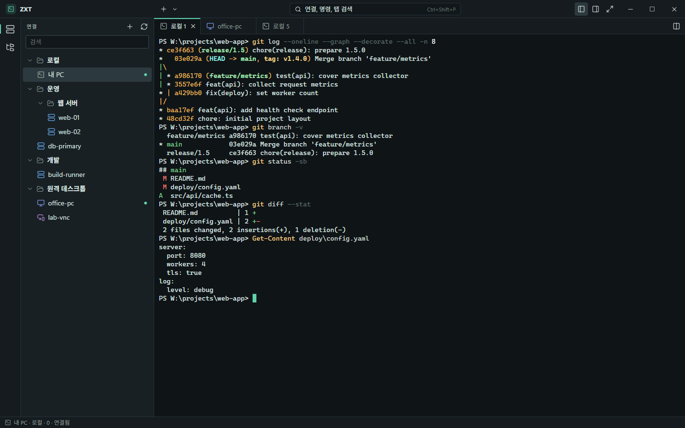
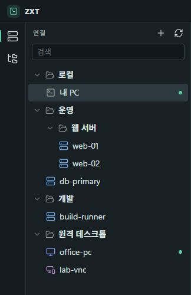
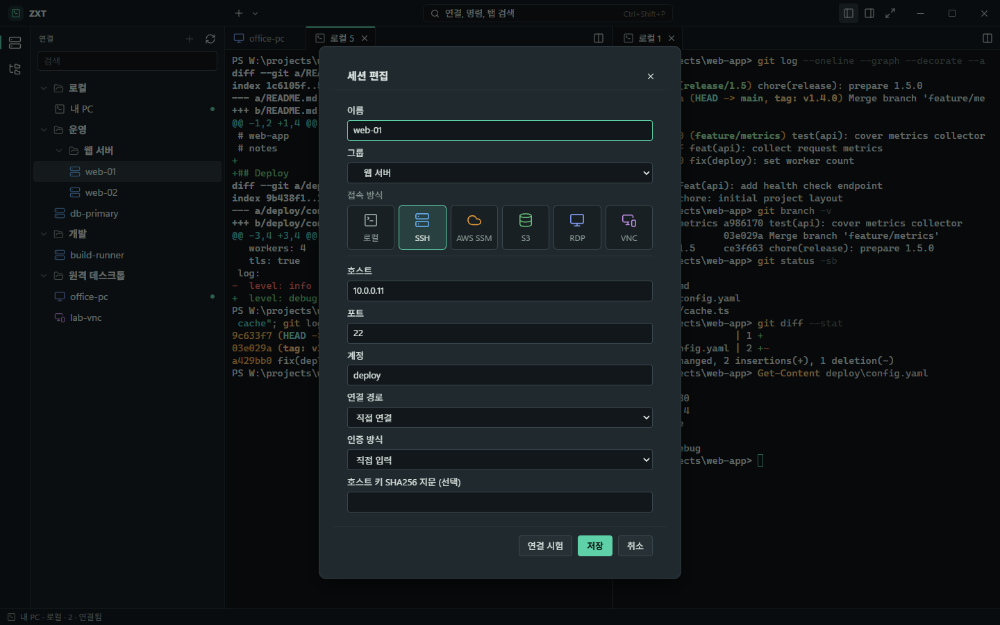
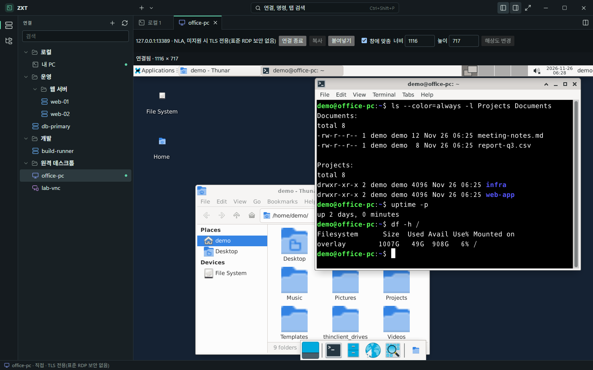
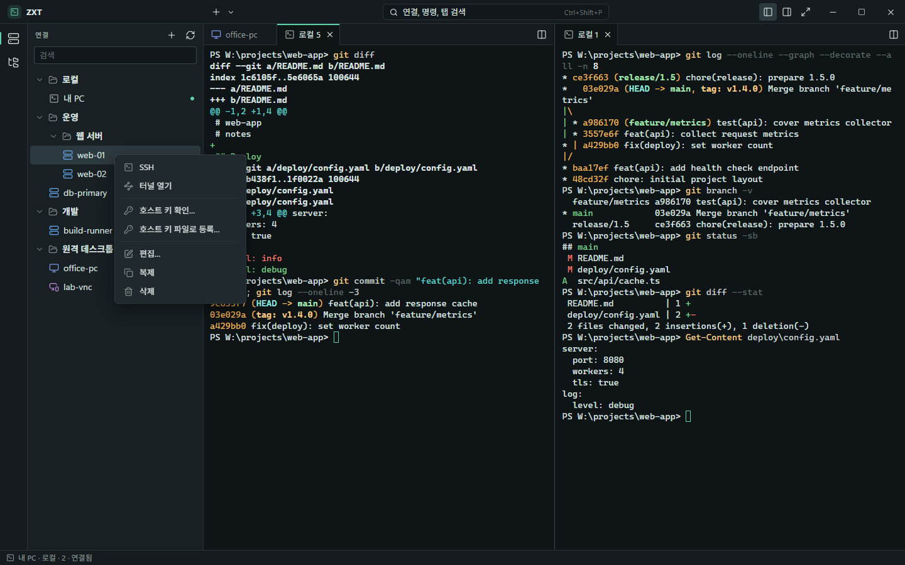
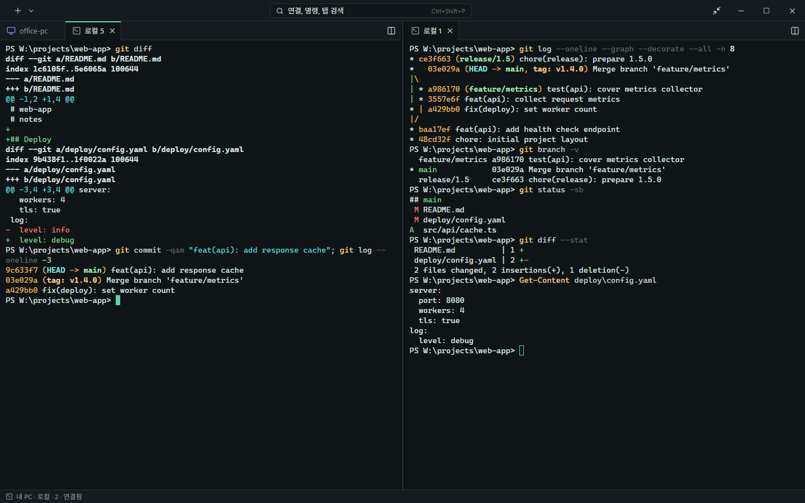
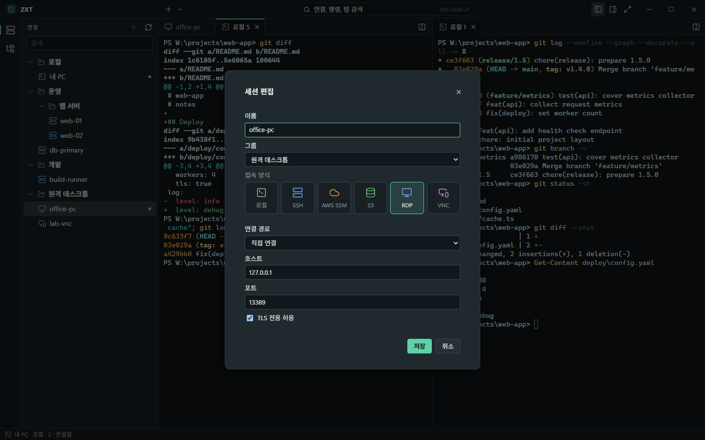

<div align="center">

# ZXT

**터미널, SSH, AWS SSM, RDP·VNC를 한 창에서 다루는 운영용 데스크톱 터미널**

[](https://github.com/hueyjeong/zxt/releases/latest)


[**다운로드**](https://github.com/hueyjeong/zxt/releases/latest) · [**사용 설명서(위키)**](https://github.com/hueyjeong/zxt/wiki)



</div>

## 주요 기능

| | |
|---|---|
| 🗂️ **연결 트리** | 중첩 그룹, 우클릭 메뉴, 한 화면짜리 세션 편집 창, 연결 시험 |
| 💻 **터미널** | 로컬 PowerShell·bash, SSH(첫 연결 때 호스트 키 확인), 한글 입력, 우클릭 복사·붙여넣기 |
| ☁️ **AWS** | SSM 셸, SSH-over-SSM, SSH·SSM 포트 터널, S3 탐색기 |
| 🖥️ **원격 데스크톱** | 내장 RDP·VNC, 창 크기 따라가기, 클립보드, 한글 입력 |
| 📝 **파일과 편집기** | SFTP 파일 탐색, 편집기 탭, `zxt-edit --wait`로 Git 편집기 연동 |
| 🤖 **AI 패널** | 로컬 Ollama 채팅과 승인 기반 조회 제안 |
| ⌨️ **명령줄 도구** | `zxt list`·`zxt register`로 연결 목록 관리 |

## 둘러보기

<table>
  <tr>
    <td width="50%"><br><sub><b>연결 트리</b> — 그룹을 겹쳐 서버를 정리한다</sub></td>
    <td width="50%"><br><sub><b>세션 편집 창</b> — 마법사 없이 한 화면에서 만들고 고친다</sub></td>
  </tr>
  <tr>
    <td><br><sub><b>RDP</b> — 탭 안에서 원격 데스크톱을 쓴다</sub></td>
    <td><br><sub><b>우클릭 메뉴</b> — 연결, 터널, 호스트 키 확인, 편집, 복제, 삭제</sub></td>
  </tr>
  <tr>
    <td><br><sub><b>터미널</b> — 탭 그룹을 나란히 띄운다</sub></td>
    <td><br><sub><b>RDP 세션 편집</b> — 주소, 계정, 보안 방식을 한 화면에서 정한다</sub></td>
  </tr>
</table>

## 설치

[Releases](https://github.com/hueyjeong/zxt/releases/latest)에서 받는다.

| OS | 파일 |
|---|---|
| Windows 11 (x64) | `ZXT_<버전>_x64-setup.exe` |
| Ubuntu 24.04 (amd64) | `ZXT_<버전>_amd64.deb` |

- 코드 서명이 없어 Windows SmartScreen 경고가 뜰 수 있다. **추가 정보 → 실행**을 누른다.
- Windows 로컬 터미널은 PowerShell 7(`pwsh`)이 필요하다.
- 자세한 준비물과 데이터 위치는 [위키의 설치 페이지](https://github.com/hueyjeong/zxt/wiki/설치)에 있다.

## 개발

```bash
cd app
npm ci
npm run tauri dev      # 개발 실행
npx vitest run         # 프런트 시험
cargo test --manifest-path src-tauri/Cargo.toml --lib
npm run bundle         # 설치 파일(Windows NSIS, Ubuntu deb)
```

- 개발 문서: [`docs/`](docs/)
- 릴리스: **Actions → Release → Run workflow**. 올릴 단계(patch·minor·major)를 고르면 버전 커밋, `vX.Y.Z` 태그, `release/vX.Y.Z` 브랜치, 설치 파일이 붙은 릴리스를 만든다. 실패하면 **실패한 작업 다시 실행**을 쓴다.
